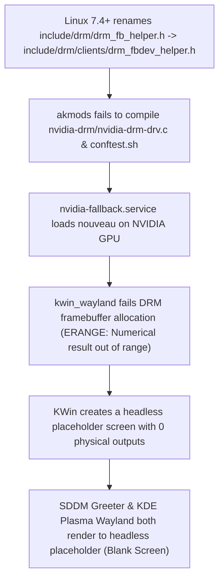

# fedora-nvidia-kernel-7.4-fix

Fixes the **missing login screen (SDDM)** and **KDE Plasma Wayland desktop failing to load after login** on Fedora Rawhide (Fedora 46+) and Linux kernel `7.4+` with NVIDIA GPUs (`akmod-nvidia` / `nvidia-drm`).

---

## Symptoms

After upgrading to a Linux `7.4.0-rc0+` kernel (e.g., `7.4.0-0.rc0.261026g6b4b543fa187.8.fc46.x86_64` on Fedora Rawhide):

1. **Missing Login Screen**: Your monitor stays black or drops to a text console on `tty1` instead of displaying the SDDM login screen.
2. **Desktop Does Not Load After Login**:
   - Typing your password blindly into `tty1` authenticates via PAM and starts `startplasma-wayland`, but the monitor remains blank.
   - Switching to `tty2`–`tty6` and logging in only opens a text shell.
3. **System Journal (`journalctl -b`) & `akmods` Logs Show**:
   ```text
   akmods: Building and installing nvidia-kmod [FAILED]
   nvidia-drm/nvidia-drm-drv.c:67:10: fatal error: drm/drm_fb_helper.h: No such file or directory
      67 | #include <drm/drm_fb_helper.h>
         |          ^~~~~~~~~~~~~~~~~~~~~
   ```
   followed by `nvidia-fallback.service` loading `nouveau` and `kwin_wayland` failing with `ERANGE`:
   ```text
   systemd[1]: Starting nvidia-fallback.service - Fallback to nouveau as nvidia did not load...
   sddm[...]: The configured theme "01-breeze-fedora" doesn't exist, using the embedded theme instead
   sddm-helper-start-wayland[...]: "kwin_wayland_drm: Failed to create framebuffer: Numerical result out of range"
   sddm-greeter-qt6[...]: There are no outputs - creating placeholder screen
   ```

---

## Root Cause



1. **Upstream Kernel Header Move (`<drm/drm_fb_helper.h>` → `<drm/clients/drm_fbdev_helper.h>`)**:
   In Linux 7.4, upstream moved `include/drm/drm_fb_helper.h` to `include/drm/clients/drm_fbdev_helper.h`. Both `nvidia-drm/nvidia-drm-drv.c` and `conftest.sh` in `nvidia-kmod` (`<= 615.78.08`) unconditionally include `<drm/drm_fb_helper.h>`, causing `akmods` to fail during boot or package upgrade.
2. **`nouveau` Fallback + NVIDIA Userspace Libraries Break `kwin_wayland_drm`**:
   When `nvidia.ko` fails to load, `nvidia-fallback.service` loads `nouveau`. With `xorg-x11-drv-nvidia-libs` installed, `kwin_wayland` fails DRM framebuffer creation with `Numerical result out of range` (`ERANGE`) and falls back to a virtual headless placeholder screen (`There are no outputs - creating placeholder screen`), leaving both SDDM and the user's Plasma Wayland desktop invisible.
3. **Missing `01-breeze-fedora` SDDM Theme**:
   During Fedora KDE Plasma 6.8 upgrades that introduce `plasma-login-manager`, `sddm-breeze` may be absent while `display-manager.service` still points to `sddm.service`.

---

## Quick Start (One-Command Fix)

Clone the repository from a TTY (`Ctrl+Alt+F3`) or SSH session and run the repair script:

```bash
git clone https://github.com/Heretek-AI/fedora-nvidia-kernel-7.4-fix.git
cd fedora-nvidia-kernel-7.4-fix
sudo ./fix-nvidia-sddm.sh
```

Or run directly with `curl`:

```bash
curl -fsSL https://raw.githubusercontent.com/Heretek-AI/fedora-nvidia-kernel-7.4-fix/main/fix-nvidia-sddm.sh | sudo bash
```

### Read-Only Diagnosis

To inspect your system without making any changes:

```bash
./fix-nvidia-sddm.sh --diagnose
```

---

## What `fix-nvidia-sddm.sh` Does

1. **Restores `<drm/drm_fb_helper.h>` Compatibility**: Creates a relative symlink `include/drm/drm_fb_helper.h -> clients/drm_fbdev_helper.h` across all installed Linux 7.4+ `/usr/src/kernels/*` trees where `clients/drm_fbdev_helper.h` replaced `drm_fb_helper.h`.
2. **Installs a Persistent Kernel `postinst.d` Hook**: Installs `/etc/kernel/postinst.d/99-nvidia-drm-fb-helper-compat` so future `dnf` / `dnf5 automatic` kernel upgrades automatically link the header before `akmods` runs.
3. **Rebuilds & Installs `kmod-nvidia`**: Runs `akmods --force --kernels <kver>` and `depmod -a`.
4. **Restores `sddm-breeze`**: Ensures the `01-breeze-fedora` SDDM theme is installed when `sddm.service` is active.
5. **Activates `nvidia_drm`**: Attempts to unload `nouveau` and start `nvidia_drm` (`modeset=1`) + `sddm.service` live, or prompts for `sudo systemctl reboot` if `nouveau` is bound to `fb0`.

---

## Repository Contents

| Path | Description |
| :--- | :--- |
| [`fix-nvidia-sddm.sh`](fix-nvidia-sddm.sh) | Diagnostic (`--diagnose`) and automated repair script for Fedora / Linux 7.4+ |
| [`hooks/99-nvidia-drm-fb-helper-compat`](hooks/99-nvidia-drm-fb-helper-compat) | `/etc/kernel/postinst.d/` hook to keep future 7.4+ kernel updates working automatically |
| [`patches/nvidia-drm-linux-7.4-fbdev-helper.patch`](patches/nvidia-drm-linux-7.4-fbdev-helper.patch) | Standalone patch for `nvidia-kmod` (`conftest.sh` & `nvidia-drm-drv.c`) using `__has_include(<drm/clients/drm_fbdev_helper.h>)` |
| [`LICENSE`](LICENSE) | MIT License |
