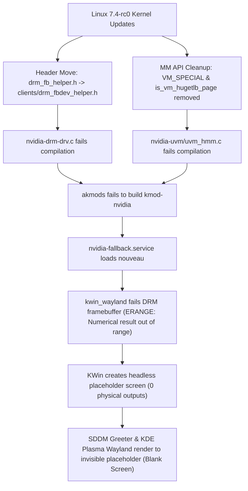

# fedora-nvidia-kernel-7.4-fix

Fixes the **missing login screen (SDDM)**, **akmod-nvidia compilation failures**, and **KDE Plasma Wayland desktop failing to load after login** on Fedora Rawhide (Fedora 46+) and Linux kernel `7.4+` with NVIDIA GPUs (`akmod-nvidia` / `nvidia-drm`).

---

## Symptoms

After upgrading to Linux `7.4.0-rc0+` kernels on Fedora Rawhide:

1. **Missing Login Screen**: Your monitor stays black or drops to a text console on `tty1` instead of displaying the SDDM login screen.
2. **Desktop Does Not Load After Login**:
   - Authenticating via PAM on `tty1` starts `startplasma-wayland`, but the monitor remains blank.
   - Switching to `tty2`–`tty6` only opens a text shell.
3. **`akmods` Build Fails on Upstream Changes**:
   - **Kernel `7.4.0-0.rc0.261026+`**:
     ```text
     akmods: Building and installing nvidia-kmod [FAILED]
     nvidia-drm/nvidia-drm-drv.c:67:10: fatal error: drm/drm_fb_helper.h: No such file or directory
        67 | #include <drm/drm_fb_helper.h>
           |          ^~~~~~~~~~~~~~~~~~~~~
     ```
   - **Kernel `7.4.0-0.rc0.261028+`**:
     ```text
     nvidia-uvm/uvm_hmm.c:4040:29: error: ‘VM_SPECIAL’ undeclared (first use in this function)
      4040 |            (vma->vm_flags & VM_SPECIAL) ||
           |                             ^~~~~~~~~~
     nvidia-uvm/uvm_hmm.c:4042:12: error: implicit declaration of function ‘is_vm_hugetlb_page’
      4042 |            is_vm_hugetlb_page(vma);
           |            ^~~~~~~~~~~~~~~~~~
     ```
4. **`nvidia-fallback.service` loads `nouveau`, causing `kwin_wayland` `ERANGE`**:
   ```text
   systemd[1]: Starting nvidia-fallback.service - Fallback to nouveau as nvidia did not load...
   sddm[...]: The configured theme "01-breeze-fedora" doesn't exist, using the embedded theme instead
   sddm-helper-start-wayland[...]: "kwin_wayland_drm: Failed to create framebuffer: Numerical result out of range"
   sddm-greeter-qt6[...]: There are no outputs - creating placeholder screen
   ```

---

## Root Causes



1. **Kernel DRM Header Move (`<drm/drm_fb_helper.h>` → `<drm/clients/drm_fbdev_helper.h>`)**:
   Upstream moved `include/drm/drm_fb_helper.h` to `include/drm/clients/drm_fbdev_helper.h`. Both `nvidia-drm/nvidia-drm-drv.c` and `conftest.sh` in `nvidia-kmod` (`<= 615.78.08`) unconditionally include `<drm/drm_fb_helper.h>`, breaking build.
2. **Kernel MM API Removals (`VM_SPECIAL` and `is_vm_hugetlb_page`)**:
   In `7.4.0-0.rc0.261028+`:
   - `VM_SPECIAL` was removed from `<linux/mm.h>`.
   - `is_vm_hugetlb_page()` was removed from `<linux/hugetlb.h>` / `<linux/hugetlb_inline.h>` in favor of `vma_is_hugetlb()`.
   `nvidia-uvm/uvm_hmm.c` fails compilation when calling these macros.
3. **`nouveau` Fallback + NVIDIA Userspace Libraries Break `kwin_wayland_drm`**:
   When `nvidia.ko` fails to load, `nvidia-fallback.service` loads `nouveau`. With `xorg-x11-drv-nvidia-libs` installed, `kwin_wayland` fails DRM framebuffer creation with `Numerical result out of range` (`ERANGE`) and falls back to a virtual headless placeholder screen (`There are no outputs - creating placeholder screen`), leaving both SDDM and the user's Plasma Wayland desktop invisible.
4. **Missing `01-breeze-fedora` SDDM Theme**:
   During Fedora KDE Plasma upgrades, `sddm-breeze` may be absent while `display-manager.service` still points to `sddm.service`.

---

## Quick Start (One-Command Fix)

Clone the repository from a TTY (`Ctrl+Alt+F3`) or SSH session and run the repair script:

```bash
git clone https://github.com/Heretek-AI/fedora-nvidia-kernel-7.4-fix.git
cd fedora-nvidia-kernel-7.4-fix
sudo ./fix-nvidia-sddm.sh
```

Or run directly with `curl`:

```bash
curl -fsSL https://raw.githubusercontent.com/Heretek-AI/fedora-nvidia-kernel-7.4-fix/main/fix-nvidia-sddm.sh | sudo bash
```

### Read-Only Diagnosis

To inspect your system without making any changes:

```bash
./fix-nvidia-sddm.sh --diagnose
```

---

## What `fix-nvidia-sddm.sh` Does

1. **Restores `<drm/drm_fb_helper.h>` Compatibility**: Creates relative symlinks `include/drm/drm_fb_helper.h -> clients/drm_fbdev_helper.h` across all installed Linux 7.4+ `/usr/src/kernels/*` trees.
2. **Installs Persistent Kernel Hooks**:
   - Installs `/etc/kernel/install.d/90-nvidia-drm-fb-helper-compat.install` so Fedora's `kernel-install` runs the link before `95-akmodsposttrans.install`.
   - Installs `/etc/kernel/postinst.d/99-nvidia-drm-fb-helper-compat` for fallback package managers.
3. **Patches `akmods` Source Package**: Updates `/usr/src/akmods/nvidia-kmod.latest` with both the DRM fbdev helper and UVM `VM_SPECIAL`/`hugetlb` compatibility patches, allowing `akmods` to compile cleanly for any future kernel build.
4. **Rebuilds & Installs `kmod-nvidia`**: Runs `akmods --force --kernels <kver>` and `depmod -a` (or installs matching prebuilt RPMs).
5. **Restores `sddm-breeze`**: Ensures the `01-breeze-fedora` SDDM theme is installed when `sddm.service` is active.
6. **Activates `nvidia_drm`**: Attempts to unload `nouveau` and start `nvidia_drm` (`modeset=1`) + `sddm.service` live, or prompts for `sudo systemctl reboot` if `nouveau` is bound to the kernel framebuffer (`fb0`).

---

## Repository Contents

| Path | Description |
| :--- | :--- |
| [`fix-nvidia-sddm.sh`](fix-nvidia-sddm.sh) | Diagnostic (`--diagnose`) and automated repair script for Fedora / Linux 7.4+ |
| [`hooks/90-nvidia-drm-fb-helper-compat.install`](hooks/90-nvidia-drm-fb-helper-compat.install) | `/etc/kernel/install.d/` hook for Fedora `kernel-install` |
| [`hooks/99-nvidia-drm-fb-helper-compat`](hooks/99-nvidia-drm-fb-helper-compat) | `/etc/kernel/postinst.d/` hook fallback |
| [`patches/nvidia-drm-linux-7.4-fbdev-helper.patch`](patches/nvidia-drm-linux-7.4-fbdev-helper.patch) | Clean patch for `nvidia-drm-drv.c` and `conftest.sh` using `__has_include(<drm/clients/drm_fbdev_helper.h>)` |
| [`patches/nvidia-uvm-linux-7.4-vm-special-hugetlb.patch`](patches/nvidia-uvm-linux-7.4-vm-special-hugetlb.patch) | Compatibility patch for `nvidia-uvm/uvm_hmm.c` restoring `VM_SPECIAL` and `is_vm_hugetlb_page` shims |
| [`LICENSE`](LICENSE) | MIT License |
